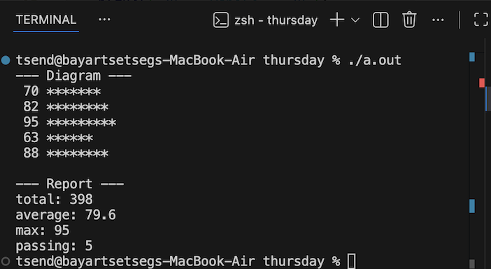

scores.c-ийн тестийн гаралт (screenshot)

ITPEC index 1 ба C index 0-ийн ялгаа:
ITPEC index 1-ээс эхэлнэ C хэл 0-ээс эхэлнэ
зассан 4 алдааны шалтгаан.
1. total 
Шалтгаан: C хэлний массив 0-ээс эхэлдэг тул  Эхлэх утга i = 0 байх ёстой.
2. average 
Шалтгаан: Хоёр бүхэл тоог хуваасан тул бутархай хэсэг хасагдсан
3. max _score
Шалтгаан:m = 0 гэж эхлүүлсэн тул сөрөг тоонууд дээр буруу ажиллана.
4. find_index
Шалтгаан:Олдоогүй үед 0 буцаасан нь эхний индекс гэж андуурагдана.

